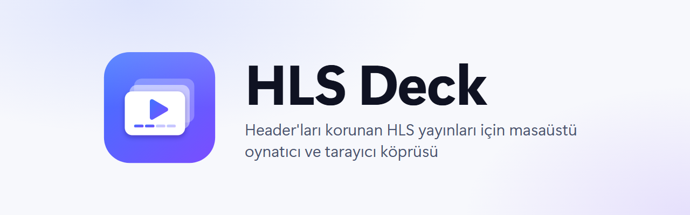
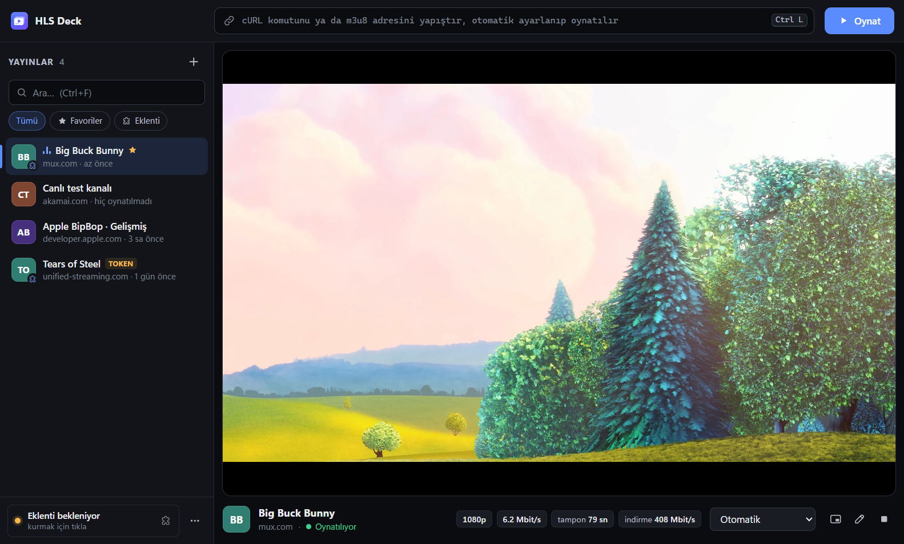
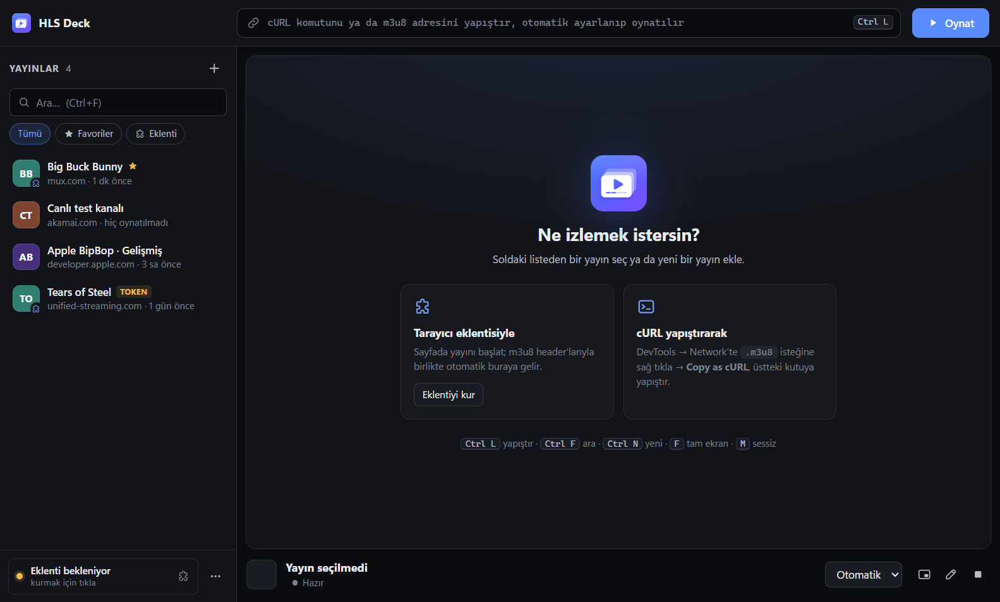
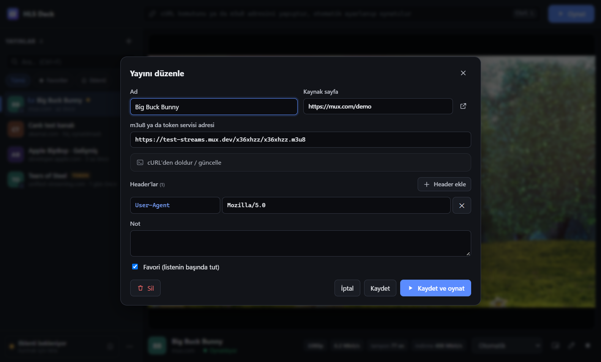

<p align="center">
  <picture>
    <source media="(prefers-color-scheme: dark)" srcset="assets/banner-dark.png">
    
  </picture>
</p>

<p align="center">
  <a href="https://github.com/yusuf-polat/hls-deck/releases/latest"></a>
  <a href="https://github.com/yusuf-polat/hls-deck/actions/workflows/test.yml"></a>
  <a href="LICENSE"></a>
  
</p>

**HLS Deck**, Referer, Origin, Cookie ya da özel token header'ı isteyen HLS (`.m3u8`) yayınlarını masaüstünde
oynatır. Header'ları tarayıcıdan **eklentiyle otomatik** alır ya da yapıştırdığın **cURL komutundan** çıkarır.
Süreli imzalı adreslerin token'ını yayın sırasında kendisi yeniler.

<p align="center"></p>

## Özellikler

- **Header'lı oynatma:** cURL'deki tüm header'lar (Referer, Origin, Cookie, User-Agent, özel token'lar) master
  playlist'ten segmentlere kadar her istekte gönderilir.
- **Tarayıcı köprüsü:** Chrome, Edge, Brave, Opera ve Vivaldi eklentisi, sayfada oynayan m3u8'i header'larıyla birlikte
  uygulamaya gönderir. Port ve token elle girilmez, ilk açılışta kurulum sihirbazı eklentiyi kurar.
- **Token yenileme:** JSON dönen token servislerini (`…/secure?url=…m3u8` → `{"Url": "…?st=…&e=…"}`) çözer.
  İmza dolmak üzereyken ya da sunucu 401/403/410 döndüğünde yeni token alır, yayın kesilmeden devam eder.
- **Yayın kütüphanesi:** favoriler, arama, filtreler, notlar, JSON içe/dışa aktarma. Aynı yayının yeni token'lı
  adresi yeni kayıt açmaz, mevcut kaydı günceller.
- **Oynatıcı:** kalite seçimi, canlı gecikme göstergesi ve "canlıya git", tampon ve bit hızı göstergeleri,
  resim içinde resim, klavye kısayolları.
- **Güvenli köprü:** yalnızca `127.0.0.1` dinler. Her istek token ister; web sayfası origin'li ve yabancı
  `Host`'lu istekler (CSRF, DNS rebinding) reddedilir.

## Kurulum

[**Son sürümü indir →**](https://github.com/yusuf-polat/hls-deck/releases/latest)

| Dosya | Açıklama |
| --- | --- |
| `HLS-Deck-Setup-<sürüm>.exe` | Kurulum sihirbazı (önerilen) |
| `HLS-Deck-<sürüm>-portable.exe` | Kurulumsuz, tek dosya |
| `HLS-Deck-Extension-<sürüm>.zip` | Tarayıcı eklentisi (elle kurulum için; uygulama zaten içinde taşır) |

> Uygulama kod imzalı değildir. Windows SmartScreen uyarısında **Ek bilgi → Yine de çalıştır**'ı seç.

### Tarayıcı eklentisi

Uygulama ilk açılışta **Tarayıcı eklentisini kur** penceresini gösterir (sonradan: sol alttaki eklenti düğmesi).

1. Kurulu tarayıcılardan birini seç; Windows'un varsayılan tarayıcısı önceden seçilidir.
2. **Kur**: tarayıcının eklenti sayfası ve eklenti klasörü açılır, klasör yolu panoya kopyalanır.
3. Tarayıcıda **Geliştirici modu** → **Paketlenmemiş öğe yükle** → yolu yapıştır (ya da klasörü sayfaya sürükle).
4. Eklenti bağlanınca pencerede **✓ Eklenti bağlandı** görünür. Token yenilense bile eklenti yenisini kendisi alır.

Chrome ve Edge, Web Mağazası dışındaki eklentilerin programla sessizce kurulmasına izin vermez. 3. adımın kullanıcıda
kalmasının nedeni budur.

## Kullanım

| Yöntem | Nasıl |
| --- | --- |
| Eklenti | Sayfada yayını başlat. Sayfadaki ilk m3u8 otomatik eklenir, diğerleri eklenti simgesinden gönderilir. |
| cURL | DevTools → Network → `.m3u8` isteğine sağ tık → **Copy as cURL** → üstteki kutuya yapıştır. |
| Adres | m3u8 ya da token servisi adresini doğrudan yapıştır. |

**Kısayollar:** <kbd>Ctrl</kbd>+<kbd>L</kbd> yapıştır · <kbd>Ctrl</kbd>+<kbd>F</kbd> ara · <kbd>Ctrl</kbd>+<kbd>N</kbd> yeni yayın ·
<kbd>F</kbd> tam ekran · <kbd>M</kbd> sessiz · <kbd>Boşluk</kbd> oynat/duraklat

<details>
<summary>Diğer ekran görüntüleri</summary>



</details>

## Nasıl çalışır?

```
Tarayıcı ──(eklenti: m3u8 + header'lar)──▶ 127.0.0.1:17865 köprü ──▶ yayın kütüphanesi
                                                                          │
hls.js ◀── stream:// proxy ◀── header'lı fetch + token oturumu ◀──────────┘
```

- Oynatıcı yayını `stream://` özel protokolü üzerinden ister. Ana süreç isteği kayıtlı header'larla yapar,
  playlist'leri yeniden yazar, segmentleri aktarır.
- **Token oturumu:** kaynak yeniden çözüldüğünde varyant ve segment adresleri imzadan bağımsız bir anahtarla eşleştirilir.
  Eski imzalı adresler taze karşılıklarına çevrilir.

## Geliştirme

```bash
npm install
npm start                 # --verbose: log · --profile=<dizin>: ayrı veri klasörü · --bridge-port=<port>
npm test                  # birim testleri (cURL, playlist, köprü, token, eklenti kurulumu)
npm run assets            # assets/icon.svg → ikonlar, .ico, banner
npm run dist              # Windows kurulum + portable exe + eklenti zip (dist/)
```

**Veriler:** `%APPDATA%\HLS Deck\`

| Dosya | İçerik |
| --- | --- |
| `streams.json` | Yayınlar (header'lar düz metin) |
| `bridge.json` | Köprü token'ı |
| `setup.json` | Eklenti kurulum durumu |
| `extension\` | Uygulamanın kurduğu eklenti kopyası |

Eski "M3U8 Player" sürümünün verileri ilk açılışta otomatik taşınır.

## Yasal not

HLS Deck, kullanıcının erişim hakkı olan yayınları oynatmak için tasarlanmış genel amaçlı bir araçtır. DRM'i
aşmaz. Yayınların kullanım koşullarına ve telif haklarına uymak kullanıcının sorumluluğundadır.

Ekran görüntülerindeki *Big Buck Bunny* © Blender Foundation (CC BY 3.0), Mux test yayını üzerinden.

## Lisans

[GPL-3.0](LICENSE) © 2026 Yusuf Polat
